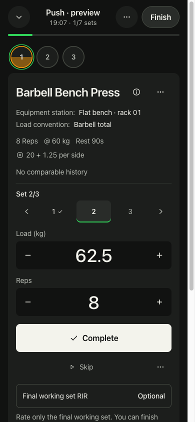
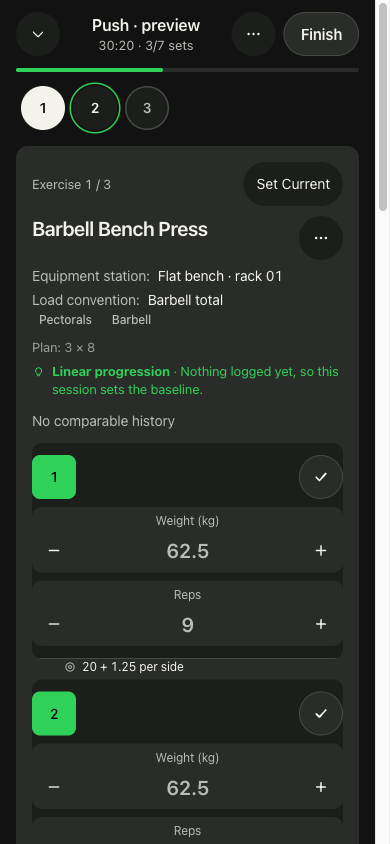
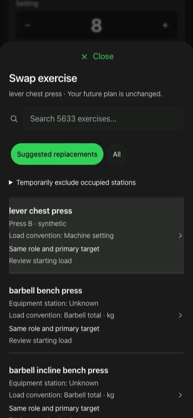
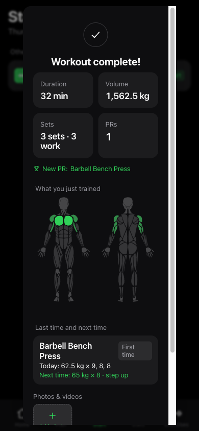

# Workout review stack

The user authorized publication for review on 2026-10-22, after the local acceptance checkpoint. No merge or deployment has occurred.

## Review order

Review and integrate the whole chain in this order. Each PR targets its predecessor so its diff contains only its own changes. After a predecessor lands, retarget the next PR to main and recheck the diff. Preserve the underlying commits when integrating the stack, or restack deliberately if using squash; do not let an automatic base change duplicate earlier changes.

| Order | PR / branch | Scope |
| --- | --- | --- |
| 1 | [#4](https://github.com/michaelportale/openGym/pull/4) · `codex/personal-strength` | planning, exact equipment/load identity, progression, coverage, adaptation and imports |
| 2 | [#5](https://github.com/michaelportale/openGym/pull/5) · `codex/workout-dependency-fixes` | Compatible tooling patches; remove unused asset generator |
| 3 | [#6](https://github.com/michaelportale/openGym/pull/6) · `codex/workout-logging-safeguards` | Unknown-load persistence through partial saves, bulk logging and restored holds |
| 4 | [#7](https://github.com/michaelportale/openGym/pull/7) · `codex/workout-accessibility` | Modal focus/isolation, closed-disclosure keyboard behavior, input naming and zoom |
| 5 | `codex/workout-visual-review` | Focus/List, rest, replacement review, Finish and final acceptance evidence |

The original local reviewed snapshot is `7faf2391389b9be110d5d7d47dcc2af9c205b309`. Application, test and dependency files at the review-stack tip are byte-for-byte identical to that snapshot; only review documentation and the synthetic screenshots below are added. Original strength and visual-snapshot branches were not rewritten. The older untracked spec in the main checkout is superseded by the completed spec already in #4; it adds no unpublished feature.

## Validation

Each intermediate frontend tree is tested, not just the combined tip. Node 22.17.0:

- Dependency tree: 5,294 frontend tests; 95 MCP tests; frontend build and MCP plain-Node graph passed.
- Safeguard tree: 5,318 frontend tests and build passed.
- Accessibility tree: 5,335 frontend tests across 413 files and production build passed. The first default-worker run hit seven timeouts and one follow-on state assertion in unchanged sync/locale tests. All 70 affected tests and then the full suite passed unchanged with two workers. Raw failure and rerun logs are retained locally; no assertion or timeout was weakened.
- Combined tree: the fresh publication pass passed 5,347 frontend tests across 414 files (two workers), 601 API tests and 95 MCP tests. Production build, locale/source checks, fatigue probes, both plain-Node graphs and generated coach assets also passed again. Earlier exact-source acceptance passed the API image build/runtime checks; those unchanged images were not rebuilt merely to split the review branches.

See [full acceptance](WORKOUT_VISUAL_ACCEPTANCE.md) and [dependency disposition](WORKOUT_DEPENDENCY_READINESS.md). Existing cosmetic build warnings remain. Audits: frontend/API/MCP 0/0/0 at the recorded readiness check. Repository Actions are documented as disabled; local verification is explicit rather than presented as hosted CI.

## Visual evidence

These are real rendered desktop-Chrome captures at a mobile viewport, using invented data. They are not physical iPhone results. No synthetic account credentials, backups, server state, personal records or vault files are published.

| Focus | List |
| --- | --- |
|  |  |

| Replacement | Saved summary |
| --- | --- |
|  |  |

## Remaining rollout check

Physical iPhone installation, real software keyboard, lock/background behavior, and airplane-mode finish/reconnect still need the bounded synthetic-data check on the user's supported HTTPS origin. Local Chrome emulation and self-signed localhost testing do not establish those device results. This limitation is unchanged by publishing the PRs.
